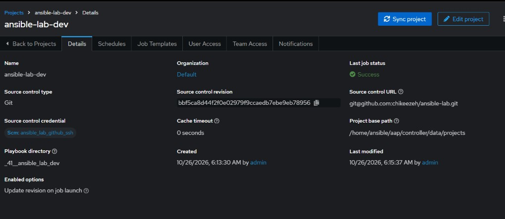
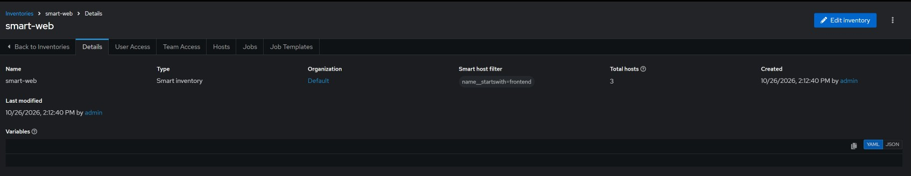
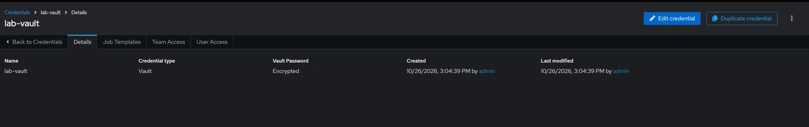
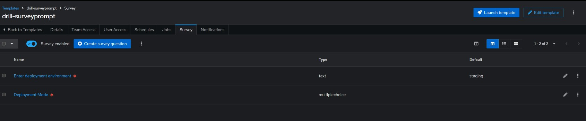
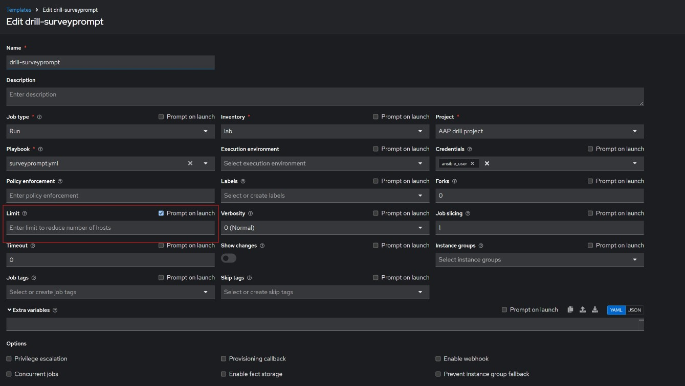

#### Manage Controller and Automation Hub

The next set of tasks will focus on the features below for AAP controller and automation hub.

Controller core: 
- Projects (Git-backed), 
- Inventories (including constructed and smart inventories), 
- Credentials, 
- Job templates.

###### Task 1 — A second project that proves update-on-launch

Create a new project in automation controller (name it `ansible-lab-dev`) pointing at your existing GitHub repo, with Update Revision on Launch enabled.
Push a small, observable change to the repo after creating the project (e.g. a marker value in a playbook or template that will show up in job output).
Launch a job template from this project without manually syncing it first.
Prove: the job's output reflects the new commit — the update-on-launch did the sync, not you.

<details>

<summary> Click to open solution </summary>

New project created, note that you have to use the ssh cloning URL if using ssh keys to access the repo. 



Edited a playbook with minor change and re-launched it without manual sync, and it picked the new changed. 

</details>

###### Task 2 — Constructed inventory

Create a constructed inventory in controller (name it constructed-lab) whose source is your existing lab inventory.
Its constructed-inventory configuration must do two things: (a) create a group containing exactly the hosts whose inventory names start with frontend, 

and (b) compose a new variable on those hosts (name and value of your choice, e.g. a tier label).

Prove: the controller's inventory host view shows the group and its members, and a job template run against that group executes only on frontend-1 and frontend-2.

Used the Source variable below to create the constructed Inventory.

```yaml
plugin: ansible.builtin.constructed
strict: false
compose:
  tier: '''frontend'''
groups:
  frontend_hosts: inventory_hostname.startswith('frontend')
```

A new group called `frontend_hosts` was created that only has the two hosts with an `inventory_hostname` starting with `frontend`.

###### Task 3 — Smart inventory, with dynamism proven

Create a smart inventory (name it smart-web) with a host filter that matches exactly the web hosts by name prefix.Prove membership first: the smart inventory's host list shows frontend-1 and frontend-2, nothing else.Then prove it's actually dynamic: add a new host to the source inventory that matches the filter, and show the smart inventory picks it up without any edit to the smart inventory itself.Prove: a job template launched against smart-web runs on its members.

See the image below for how the smart inventory is created.



###### Task 4 — Vault credential, used by a job

Create a Vault credential in controller (name it lab-vault) and a vault-encrypted variable file in the repo (use the same vault password) defining one variable of your choice.Write a playbook task that consumes that variable into a config file on a host — do not print the value with debug in job output; the file on the host is the proof.

Create a job template with the Vault credential attached and launch it.Prove: job output (successful run, no vault error) plus cat of the config file on the host showing the decrypted value in place.

See the credential screenshot below:



Then created the playbook below to consume the vault key.

```yaml
---
- name: consume a vault encrypted file
  hosts: localhost
  vars_files:
   - encryvar.yml
  tasks:
  - name: Create a config file
    ansible.builtin.copy:
      dest: /tmp/vaultconfig
      content: "{{ test }}"
```


###### Task 5 — Job template survey + prompt-on-launch limit

Create a job template with a survey containing: a required text variable deploy_env (default staging), and a multiple-choice variable deploy_mode with at least two options.The playbook must write both values into /tmp/survey-proof.txt on the target hosts.

Enable Prompt on Launch for limit on the same template.

Prove: one launch with custom survey answers (file contents match the answers), and one launch with a limit of frontend-1 only (recap shows only frontend-1 ran).

See the survey questions below:



Used the playbook below to test the survey.

```yaml
---
- name: Create a survey file
  hosts: all
  tasks:
  - name: create a file
    ansible.builtin.copy:
      dest: /tmp/survey-proof.txt
      content: |
        {{ deploy_env }}
        {{ deploy_mode }}

```
To limit the play to only `frontend-1`, I used the Prompt on Launch option for limit. Then put in frontend-1 as the only host to run the playbook on.




Task 6 — Capstone: the full controller stack

Assemble one job template that combines the block: the update-on-launch project, the smart-web inventory, the lab-vault credential, and a survey — driving a playbook that uses both a survey variable and the vaulted variable.

Prove: two launches with different survey answers produce different artifacts on the hosts; a third launch repeating one answer set is changed=0.

For this I combined task 4 and 5, see resulting playbook below:

```yaml
---
- name: A captsone that contains all the drills for controller
  hosts: all
  vars_files:
    - encryvar.yml
  tasks:
  - name: create a file
    ansible.builtin.copy:
      dest: /tmp/controllercap.txt
      content: |
        {{ deploy_env }}
        {{ deploy_mode }}
        {{ test }}

```