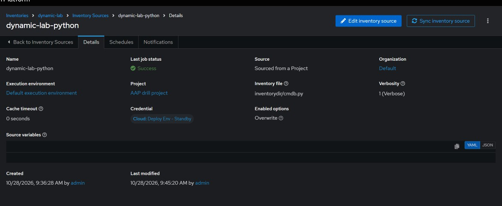
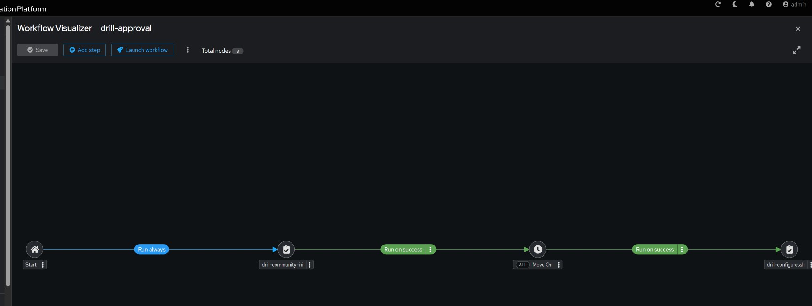
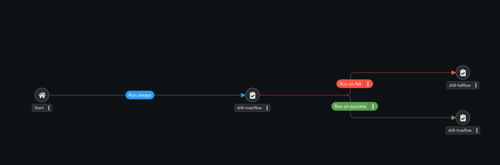
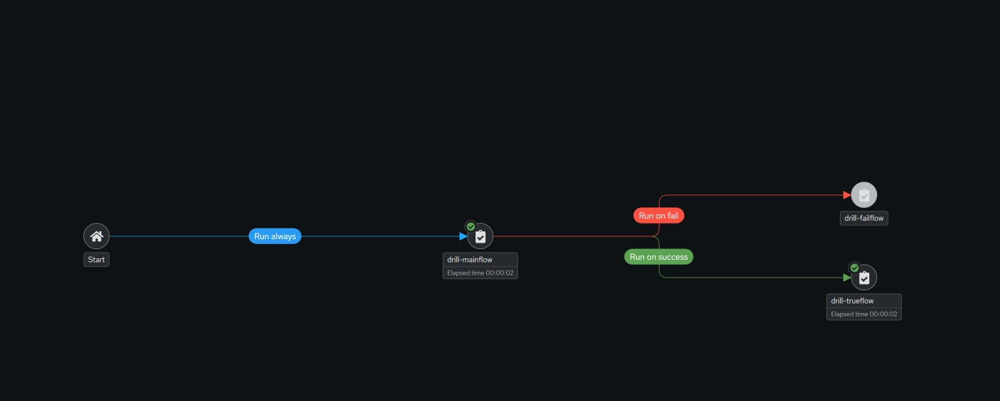
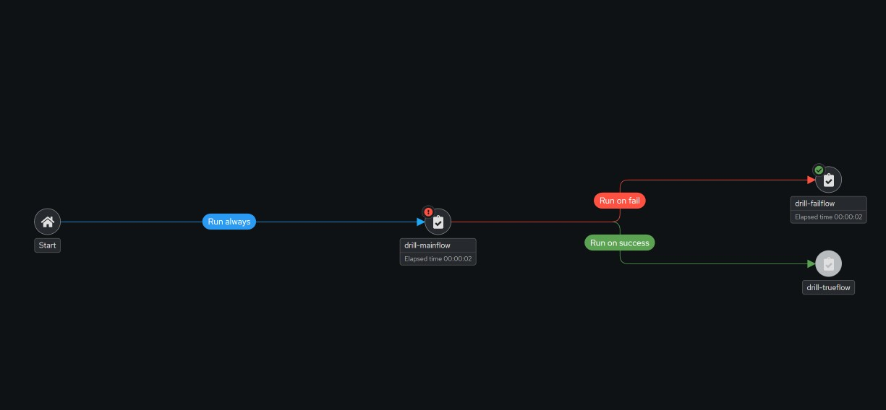

#### Advanced controller task - drills

###### Task 1 — Dynamic inventory script
Write an executable inventory script in the repo (e.g. inventory/cmdb.py) that reads hosts from a data file (e.g. inventory/cmdb.json) — the data file stands in for your CMDB/database. The script must support --list (full inventory JSON with _meta.hostvars) and --host <name> (that host's variables).Prove: --list output, --host output for one host, and ansible-inventory --graph against the script showing the groups.Then prove dynamism: add a host to the data file and show it appears in --list output with no change to the script.

<details>

<summary> Click to open solution </summary>

See below json file created for this; note for initial testing vm4 was not added. 

```json
{
  "frontend-1": {
    "ansible_host": "vm1",
    "groups": ["web"]
  },
  "frontend-2": {
    "ansible_host": "vm2",
    "groups": ["web"]
  },
  "vm3": {
    "ansible_host": "vm3",
    "groups": ["db"]
  },
   "vm4": {
    "ansible_host": "vm4",
    "groups": ["ubuntu"]
  }
}

```

See below the Python script for reading the json file and turning it into an ansible inventory, made the script executable after creating it. 

```python
#!/usr/bin/env python3
"""
Custom dynamic inventory script reading from cmdb.json.
Supports:
  --list          Outputs inventory with groups and _meta.hostvars
  --host <name>   Outputs variables for a specific host
"""

import argparse
import json
import os
import sys

DATA_FILE = os.path.join(os.path.dirname(os.path.abspath(__file__)), "cmdb.json")


def load_cmdb():
    try:
        with open(DATA_FILE, "r") as f:
            return json.load(f)
    except FileNotFoundError:
        sys.stderr.write(f"Error: Database file not found at {DATA_FILE}\n")
        sys.exit(1)
    except json.JSONDecodeError as exc:
        sys.stderr.write(f"Error parsing {DATA_FILE}: {exc}\n")
        sys.exit(1)


def build_inventory_list(data):
    inventory = {
        "_meta": {
            "hostvars": {}
        },
        "all": {
            "hosts": list(data.keys())
        }
    }

    for hostname, attributes in data.items():
        # Copy attributes so we don't mutate the source
        host_attrs = dict(attributes)
        groups = host_attrs.pop("groups", [])

        # Assign hostvars
        inventory["_meta"]["hostvars"][hostname] = host_attrs

        # Assign to groups
        for group in groups:
            if group not in inventory:
                inventory[group] = {"hosts": [], "vars": {}}
            if hostname not in inventory[group]["hosts"]:
                inventory[group]["hosts"].append(hostname)

    return inventory


def get_host_vars(data, hostname):
    if hostname in data:
        host_attrs = dict(data[hostname])
        host_attrs.pop("groups", None)
        return host_attrs
    return {}


def main():
    parser = argparse.ArgumentParser(description="Ansible Dynamic Inventory Script")
    group = parser.add_mutually_exclusive_group(required=True)
    group.add_argument("--list", action="store_true", help="List all hosts and groups")
    group.add_argument("--host", action="store", help="Get variables for a single host")

    args = parser.parse_args()
    data = load_cmdb()

    if args.list:
        output = build_inventory_list(data)
    elif args.host:
        output = get_host_vars(data, args.host)

    print(json.dumps(output, indent=2))


if __name__ == "__main__":
    main()

```

See below when you run the script with the `--list` option.

```shell
[ansible@tower ansible-lab (main %)]$ ./inventorydir/cmdb.py --list
{
  "_meta": {
    "hostvars": {
      "frontend-1": {
        "ansible_host": "vm1"
      },
      "frontend-2": {
        "ansible_host": "vm2"
      },
      "vm3": {
        "ansible_host": "vm3"
      },
      "vm4": {
        "ansible_host": "vm4"
      }
    }
  },
  "all": {
    "hosts": [
      "frontend-1",
      "frontend-2",
      "vm3",
      "vm4"
    ]
  },
  "web": {
    "hosts": [
      "frontend-1",
      "frontend-2"
    ],
    "vars": {}
  },
  "db": {
    "hosts": [
      "vm3"
    ],
    "vars": {}
  },
  "ubuntu": {
    "hosts": [
      "vm4"
    ],
    "vars": {}
  }
}
```

Also, using the `--graph` flag.

```shell
[ansible@tower ansible-lab (main %)]$  ansible-inventory -i inventorydir/cmdb.py --graph
@all:
  |--@ungrouped:
  |--@web:
  |  |--frontend-1
  |  |--frontend-2
  |--@db:
  |  |--vm3
  |--@ubuntu:
  |  |--vm4
```


</details>

###### Task 2 — Dynamic inventory in controller

Create an inventory in controller (name it dynamic-lab) with a source of type "Sourced from a Project" pointing at the script in your ansible-lab-dev project. 

Sync it.Prove: the controller's host list shows the script's hosts, and a job template run against dynamic-lab executes on them.

Then prove controller-side dynamism: edit the data file, push, re-sync the source, and show the new host appearing in the controller inventory.

See below the dynamic-lab source, reading from the python script.



###### Task 3 — Workflow with an approval gate

Build a workflow job template (name it drill-workflow-approval) with three nodes: Job A → Approval → Job B. Job A and B can be simple existing playbooks (a config write and a verification read).Prove: launch the workflow and show it pausing at the approval node, then approve it in the UI and show Job B running to success. The workflow output must show all three nodes in order.

<details>

<summary>Click to open solution</summary>

Will use community.yml as Job A and configuressh.yml as the Job B. 

See below the visualizer.



</details>

###### Task 4 — Workflow branching: success and failure paths

Build a second workflow (drill-workflow-branch) whose first node runs a job template that accepts an extra variable (e.g. force_fail, default false) and fails the play when it's true. The workflow must route the node's success edge to one job and its failure edge to a different job.Prove both paths with two launches: once with the variable false (success branch runs, failure branch does not), once with it true (failure branch runs, success branch does not). Both workflow outputs required.

<details>

<summary>Click to open solution</summary>

I created 3 simple playbooks, the main node which has a variable that will be set by survey prompt in the AAP UI.

```yaml
---
- name: playbook to practice fail branching
  hosts: localhost
  gather_facts: false
  tasks:
  - name: Use the failvalue
    debug:
      msg: " Hello World "
    failed_when: failvalue | bool

```

When the main node passes;

```yaml
---
- name: playbook to practice fail branching
  hosts: localhost
  gather_facts: false
  tasks:
  - name: Use when pass
    debug:
      msg: "My parent job passed"

```

When the main node fails;

```yaml
---
- name: playbook to practice fail branching
  hosts: localhost
  gather_facts: false
  tasks:
  - name: Use when failed
    debug:
      msg: "My parent job failed"
```

See images from AAI UI.



---



---



</details>